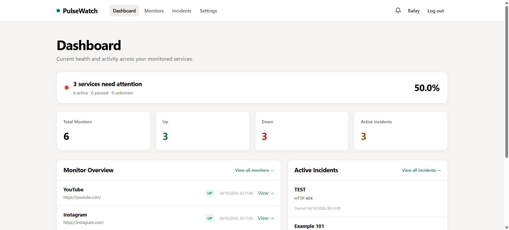
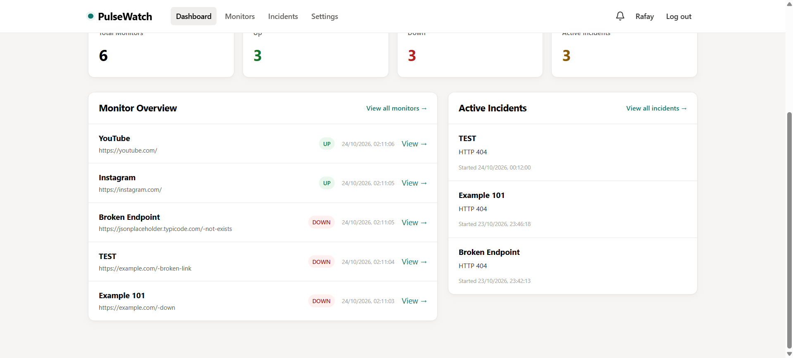
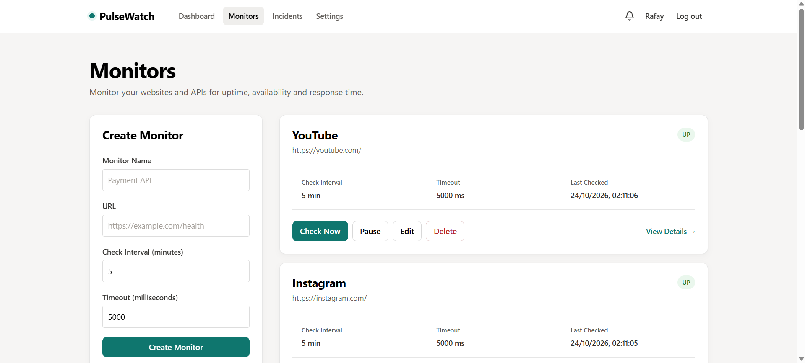
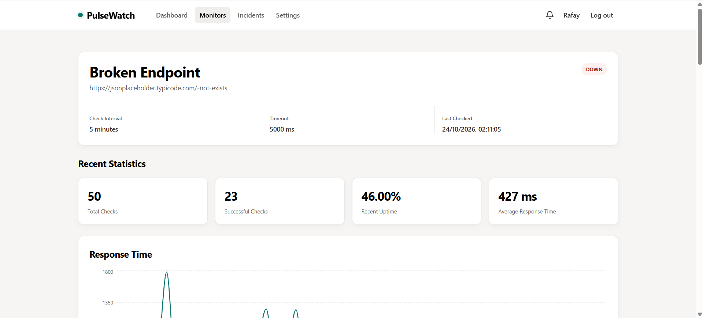
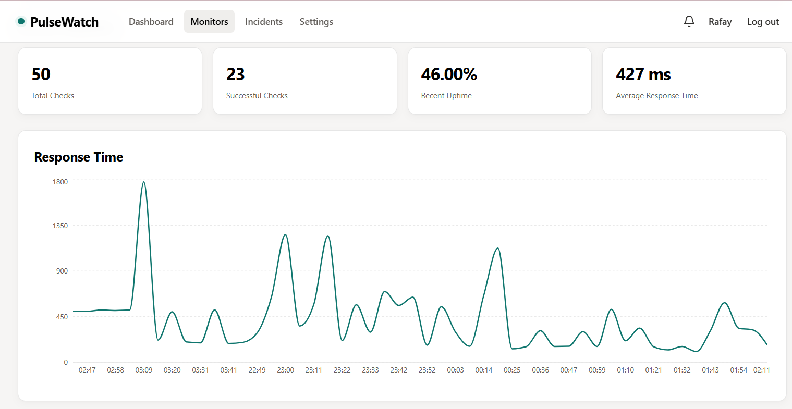
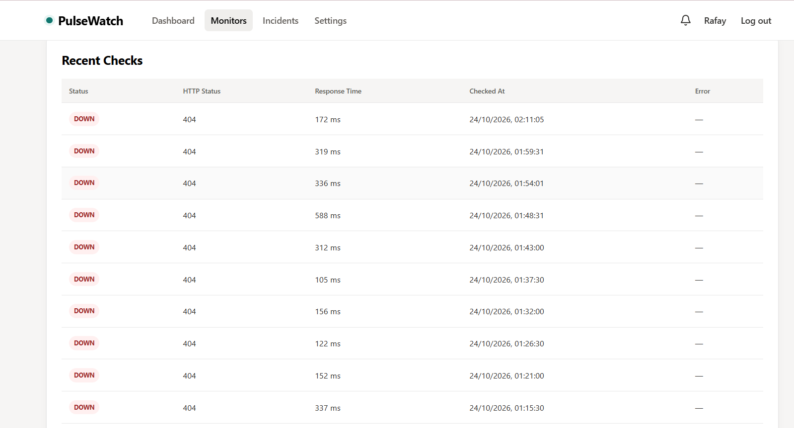
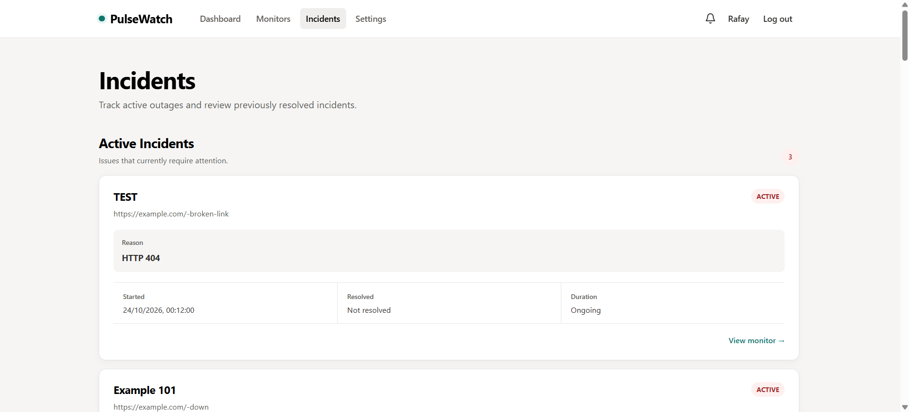
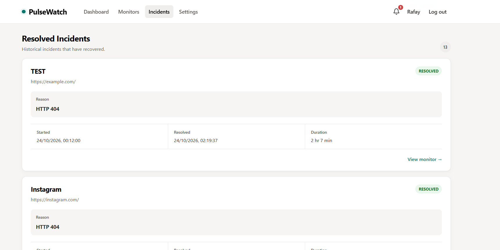
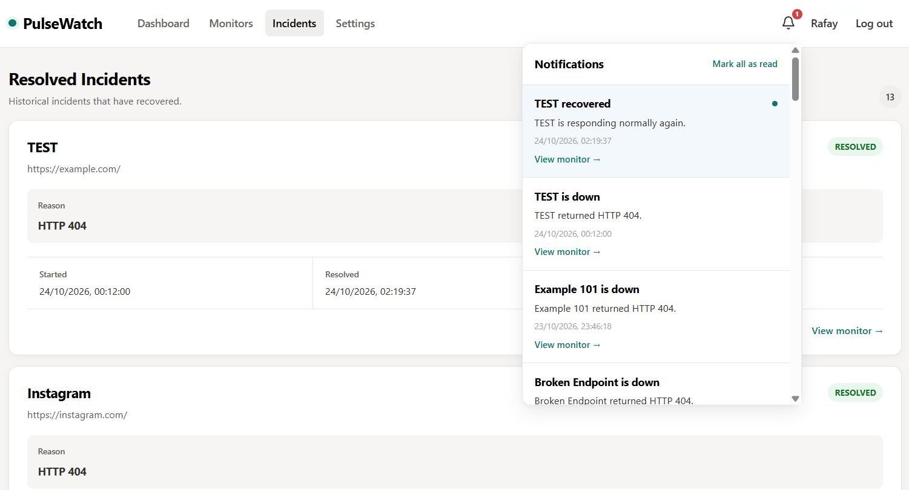
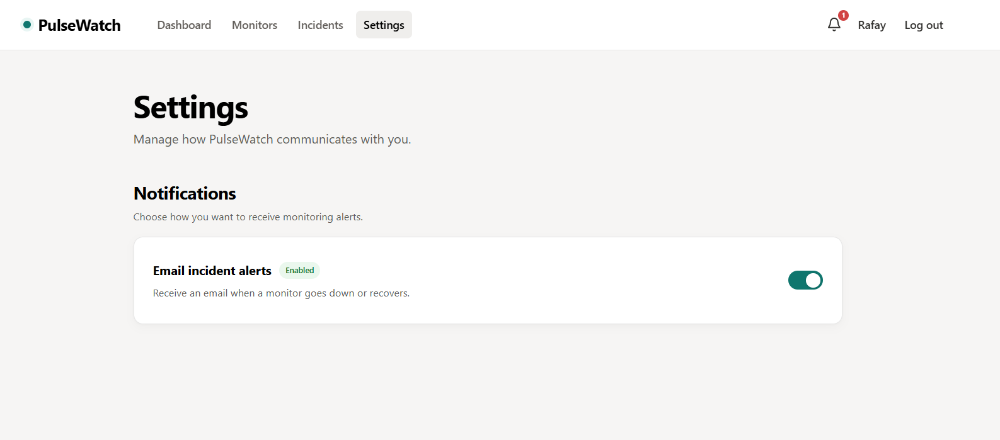

# PulseWatch

PulseWatch is a full-stack website and API monitoring platform for tracking endpoint availability, response time, outages, recoveries, and incident history.

It automatically checks configured endpoints, records monitoring results, detects failures and recoveries, creates and resolves incidents, and sends in-app and email notifications when service status changes.

## Demo

🎥 **Video Demo:** [Watch the PulseWatch Demo](https://www.youtube.com/watch?v=FQ9YzMvwMoA&t=19s)

## Features

### Website & API Monitoring
- Create and manage HTTP/HTTPS monitors
- Configure monitoring interval and request timeout
- Manually trigger monitor checks
- Pause and resume monitoring
- Automatic background monitoring

### Monitoring Engine
- Records HTTP status codes
- Measures response time
- Stores check history
- Detects UP and DOWN state transitions
- Retries temporary failures before declaring an outage

Retryable failures include:
- Network errors
- DNS failures
- Request timeouts
- HTTP 408 responses
- HTTP 429 responses
- HTTP 5xx responses

### Incident Management
- Automatically creates incidents when a service goes down
- Prevents duplicate active incidents
- Automatically resolves incidents when services recover
- Calculates incident duration
- Maintains resolved incident history

### Dashboard & Analytics
- Overall service health percentage
- Total monitor count
- UP and DOWN monitor counts
- Active incident count
- Recent monitor status overview
- Response-time charts
- Recent uptime statistics
- Average response time
- Complete recent check history

### Notifications
- In-app outage notifications
- Recovery notifications
- Email incident alerts
- User-controlled email notification preferences

### Authentication
- User registration and login
- Secure password hashing with bcrypt
- JWT access tokens
- Database-backed refresh sessions
- Refresh-token rotation
- Protected API routes
- Persistent login sessions
- Logout session revocation

### Security

PulseWatch includes protection against Server-Side Request Forgery (SSRF).

Monitor targets are validated both when they are stored and when monitoring requests are executed.

Security measures include:
- HTTP and HTTPS protocols only
- Rejection of malformed URLs
- Blocking localhost targets
- Blocking private and reserved IP addresses
- DNS resolution validation
- Validation of all resolved IP addresses
- Protection against IPv4-mapped IPv6 addresses
- Request connection pinning to validated IP addresses
- Manual redirect handling
- Redirect destination revalidation
- Redirect limits
- Blocking redirects to internal network addresses
- Rejection of URLs containing credentials

## Tech Stack

### Frontend
- React
- Vite
- React Router
- Axios
- Recharts
- CSS

### Backend
- Node.js
- Express.js
- MongoDB
- Mongoose
- JSON Web Tokens
- bcrypt
- Nodemailer
- Undici
- ipaddr.js

### Testing
- Jest
- Supertest
- MongoDB Memory Server

## Automated Testing

The PulseWatch backend includes **42 automated tests across 7 test suites**.

Tests cover:
- Authentication and login
- Signup and password security
- Access-token protected routes
- Refresh-token rotation
- Logout and session revocation
- Monitor creation and validation
- Monitor ownership and user isolation
- URL security validation
- Monitor lifecycle behavior
- Incident creation and resolution
- Duplicate incident prevention
- Notification generation
- User email preferences
- Email alert behavior
- Paused monitor behavior
- Missing monitor handling

Run the backend test suite with:

```bash
npm test
```

## Project Architecture

```text
pulsewatch/
├── backend/
│   └── src/
│       ├── config/
│       ├── features/
│       │   ├── auth/
│       │   └── notifications/
│       ├── middleware/
│       ├── modules/
│       │   ├── auth/
│       │   ├── checks/
│       │   ├── incidents/
│       │   ├── monitors/
│       │   └── users/
│       ├── services/
│       ├── app.js
│       └── server.js
│
└── frontend/
    └── src/
        ├── app/
        ├── features/
        │   ├── auth/
        │   ├── dashboard/
        │   ├── incidents/
        │   ├── monitors/
        │   ├── notifications/
        │   └── settings/
        ├── lib/
        └── shared/
```

## How Monitoring Works

A monitoring cycle follows this general flow:

```text
Monitor
   ↓
Scheduler / Manual Check
   ↓
URL & DNS Security Validation
   ↓
HTTP Request
   ↓
Retry Logic
   ↓
Store Check Result
   ↓
Detect State Transition
   ↓
Incident Handling
   ↓
Notification / Email Alert
```

If a service changes from UP to DOWN:

```text
UP → DOWN
     ↓
Create Incident
     ↓
Create Notification
     ↓
Send Email Alert
```

Repeated failed checks do not create duplicate incidents.

When the service recovers:

```text
DOWN → UP
       ↓
Resolve Incident
       ↓
Calculate Downtime
       ↓
Create Recovery Notification
       ↓
Send Recovery Email
```

## Running the Project Locally

### Prerequisites
- Node.js
- npm
- MongoDB

### 1. Clone the Repository

```bash
git clone YOUR_GITHUB_REPOSITORY_URL
cd pulsewatch
```

### 2. Backend Setup

```bash
cd backend
npm install
```

Create a `.env` file using your environment configuration.

Example:

```env
PORT=5000
MONGODB_URI=your_mongodb_connection_string
JWT_ACCESS_SECRET=your_access_token_secret
EMAIL=your_email
EMAIL_PASSWORD=your_email_app_password
SENDER_EMAIL=your_sender_email
SENDER_NAME=PulseWatch
```

Start the backend:

```bash
npm run dev
```

The API will run locally on:

```text
http://localhost:5000
```

### 3. Frontend Setup

Open another terminal:

```bash
cd frontend
npm install
```

Create:

```text
frontend/.env
```

Example:

```env
VITE_API_URL=http://localhost:5000/api
```

Start the frontend:

```bash
npm run dev
```

The frontend will normally run on:

```text
http://localhost:5173
```

## Production Build

Create a production frontend build with:

```bash
npm run build
```

Preview the production build locally with:

```bash
npm run preview
```

## Screenshots

### Dashboard




### Monitor Management



### Monitor Details & Analytics





### Incident Management




### Notifications



### Settings



## What I Learned

Building PulseWatch gave me practical experience with:
- Full-stack application architecture
- REST API design
- React state management
- Authentication and session management
- JWT access and refresh tokens
- Background task scheduling
- HTTP request handling
- Retry strategies
- State-transition logic
- Incident lifecycle management
- Email notification systems
- MongoDB data modeling
- SSRF protection
- DNS and redirect security
- Integration testing
- API testing
- Responsive UI design
- Production build preparation

## Author

**Abdul Rafay Siddiqui**

Software Engineering Graduate / Full-Stack Developer

GitHub: [https://github.com/AbdulRafay77]

LinkedIn: [https://www.linkedin.com/in/abdulrafayse/]

## License

This project is intended primarily as a portfolio and learning project.
